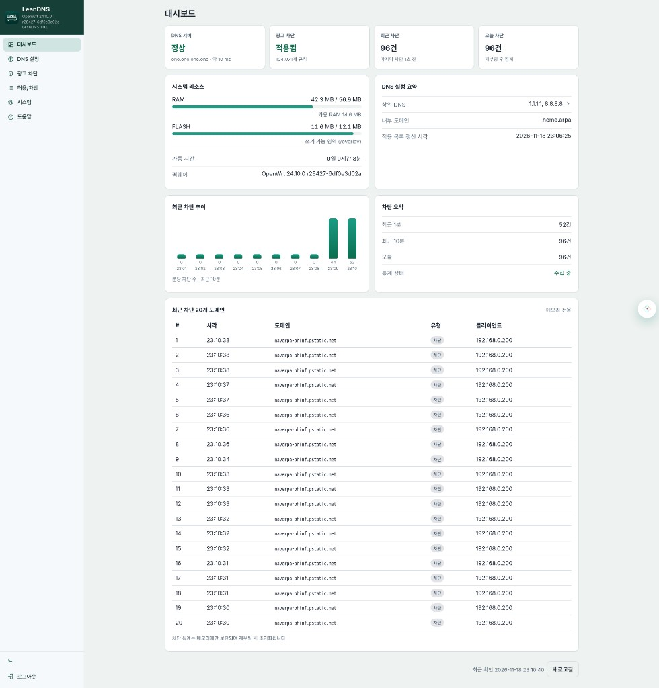
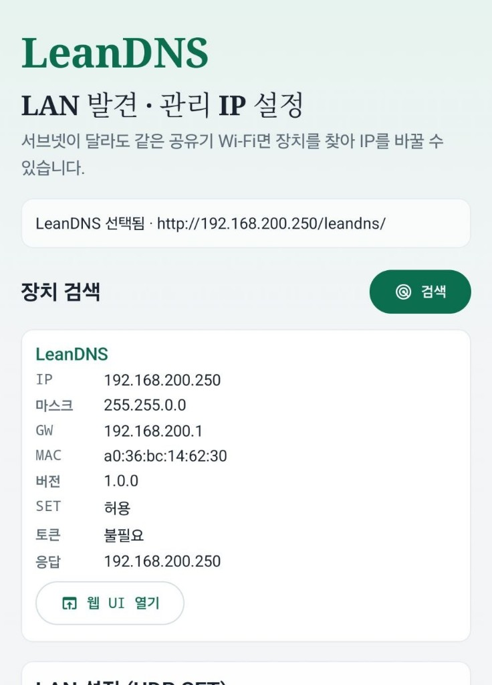
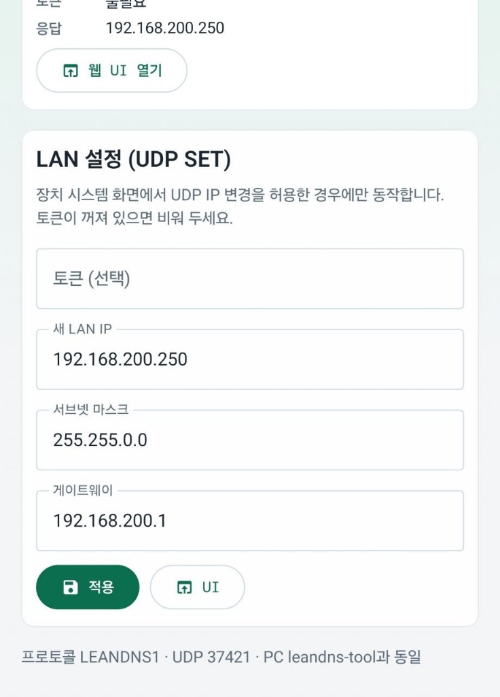

# LeanDNS

OpenWrt 기반 **초경량 스마트 DNS** 관리 시스템입니다.

메인 공유기는 그대로 두고, LeanDNS 장치가 DNS·광고 차단만 담당합니다.  
관리 UI는 dnsmasq + adblock-lean 위에 올린 **한국어 웹 화면**이며, DNS 엔진을 새로 만들지 않습니다.

## 이런 분께 맞습니다

- 집/소규모 LAN에서 광고를 줄이고 DNS를 한곳에서 관리하고 싶을 때
- AdGuard Home급 관리 경험은 원하지만, 저사양 공유기(64MB RAM / 16MB Flash급)에 맞춰야 할 때
- 서브넷이 바뀌어 웹 접속이 안 될 때, 폰/PC로 장치를 찾아 IP를 다시 잡고 싶을 때

## 지원 범위

| 구분 | 내용 |
|------|------|
| 이론적으로 가능 | **OpenWrt 24.10.x**에서 dnsmasq·adblock-lean·uhttpd/rpcd를 쓸 수 있고, Flash·RAM이 위 구성에 충분한 장치 |
| 테스트 완료 | **ASUS RT-AC750L** (= OpenWrt `asus_rt-ac1200-v2`, 64MB RAM / 16MB Flash) |

다른 기종은 보드·이미지·복구 경로가 다를 수 있으니, 해당 기기의 OpenWrt 문서와 [docs/hardware.md](docs/hardware.md)를 함께 확인하세요.

## 구성 요약

| 항목 | 내용 |
|------|------|
| OS | OpenWrt 24.10.x |
| DNS / 광고 차단 | dnsmasq + adblock-lean Mini |
| 웹 UI | `http://<장치IP>/leandns/` (루트 `/`에서도 동일) |
| 인증 | OpenWrt **root** + rpcd ubus 세션 (LuCI UI / luci-base 미포함) |
| 기본 LAN | `192.168.0.250/24`, GW `192.168.0.1`, DHCP 서버 끔 |
| 이미지 성격 | DNS 전용: Wi‑Fi·PPP·firewall4/nft 스택 제외 (메인 공유기 뒤 LAN 전제) |
| 펌웨어 산출물 | `leandns-*-sysupgrade.bin` (웹/sysupgrade), `leandns-*-factory.bin` (ASUS Restoration) |
| 장치 발견 | `leandns-discoverd` (C, UDP **37421**, 프로토콜 LEANDNS1) |

설치·복구·보안 등 자세한 절차는 [문서](#문서)를 보세요.

## 관리 UI

브라우저에서 `http://<장치IP>/` 또는 `/leandns/`로 접속합니다.  
DNS 상태·광고 차단·허용/차단 목록·LAN/UDP·펌웨어를 한국어 화면에서 관리합니다.

### 대시보드

DNS·광고 차단 상태, RAM/Flash, 상위 DNS 요약과 함께  
**최근·오늘 차단 통계**, 10분 추이 차트, **최근 차단 20개 도메인**을 한눈에 봅니다.  
차단 집계는 `/tmp`(RAM)만 사용하며 재부팅 시 초기화됩니다.



### DNS 설정

상위 DNS, 캐시, AAAA 응답, 연결 테스트, 내부 DNS 레코드를 설정합니다.


### 광고 차단

adblock-lean Mini 목록 on/off, 수동 업데이트, 규칙 수를 확인합니다.


### 시스템

펌웨어·네트워크·저장공간·RAM 상태와 함께  
LAN IP/게이트웨이 **즉시 영구 적용**, UDP 토큰·SET 허용,  
로그·서비스 재시작, 설정 내보내기/가져오기, **웹 펌웨어 업그레이드**를 합니다.

- 업로드는 `leandns-*-sysupgrade.bin`만 허용합니다 (`*-factory.bin`은 Firmware Restoration용).
- 이미지는 `/tmp`(RAM)에 한 번만 두고, 검사 통과 후 명시 확인으로 적용합니다.
- 자동 다운로드·자동 플래시는 하지 않습니다.


## Android 앱 — 장치 찾기 · LAN IP 변경

서브넷이 달라도 **같은 공유기 Wi‑Fi**에 있으면 장치를 찾고 IP를 바꿀 수 있습니다.  
PC용 `leandns-tool`과 같은 프로토콜(**LEANDNS1 · UDP 37421**)을 씁니다.

소스: [`android/leandns-tool/`](android/leandns-tool/)

### 장치 검색

폰을 집 Wi‑Fi에 연결한 뒤 **검색**을 누르면 LeanDNS 장치가 나타납니다.  
IP·마스크·게이트웨이·MAC·버전·토큰/SET 허용 여부를 확인하고, **웹 UI 열기**로 관리 화면에 바로 들어갈 수 있습니다.



### LAN 설정 (UDP SET)

발견한 장치의 IP / 서브넷 마스크 / 게이트웨이를 바꾼 뒤 **적용**합니다.  
시스템 화면에서 **UDP IP 변경**이 켜져 있어야 하며, 토큰이 필요하면 입력합니다(끄면 비워 둠).  
UDP SET은 **임시 적용**이므로, 적용 후 **120초 안에** 웹 UI에서 LAN 설정을 확정하세요. (기한 지나면 이전 설정으로 복구)  
웹 UI의 「네트워크 적용」은 즉시 영구 반영됩니다.



### 사용 순서

1. 폰을 메인 Wi‑Fi에 연결
2. 앱에서 **검색** → 장치 선택
3. 필요하면 토큰 입력 후 **적용**
4. 웹 UI에서 120초 안에 LAN 설정 확정

APK 빌드(Windows 11): Android Studio에서 `android\leandns-tool` 열기 → **Build → Build APK(s)**  
또는 `gradlew.bat assembleDebug` → `app\build\outputs\apk\debug\app-debug.apk`

## PC에서 같은 작업

```bat
leandns-tool-windows-amd64.exe discover

leandns-tool-windows-amd64.exe set ^
  --token "웹에표시된토큰" ^
  --ip 192.168.34.250 ^
  --netmask 255.255.255.0 ^
  --gateway 192.168.34.1
```

빌드: `./scripts/build-udp-tool.sh` → `dist/leandns-tool/`  
장치 데몬: `./scripts/build-discoverd.sh` (C mipsel softfloat)  
상세: [docs/udp-tool.md](docs/udp-tool.md)

## 로컬에서 UI만 미리보기

```bash
./host/run.sh
# 브라우저: http://127.0.0.1:8765/
# 로그인: 임의 사용자 / 임의 비밀번호 (wrongpassword 제외)
```

Windows 11: WSL2 또는 Python3 환경에서 동일하게 실행합니다.

## 문서

| 문서 | 내용 |
|------|------|
| [docs/installation.md](docs/installation.md) | 설치 · factory/sysupgrade 이미지 |
| [docs/udp-tool.md](docs/udp-tool.md) | UDP 발견 / IP 설정 (PC·Android) |
| [docs/architecture.md](docs/architecture.md) | 아키텍처 · 차단 통계 정책 |
| [docs/hardware.md](docs/hardware.md) | 하드웨어·호환성 |
| [docs/recovery.md](docs/recovery.md) | 복구 |
| [docs/security.md](docs/security.md) | 보안 · 펌웨어 업로드 정책 |
| [docs/metrics.md](docs/metrics.md) | 크기·리소스 실측 |

> 실기 플래시·파괴적 네트워크 적용은 **사용자 승인 후**에만 진행하세요.  
> 테스트 완료 목록에 없는 기기는 자체 검증 후 사용하세요.
