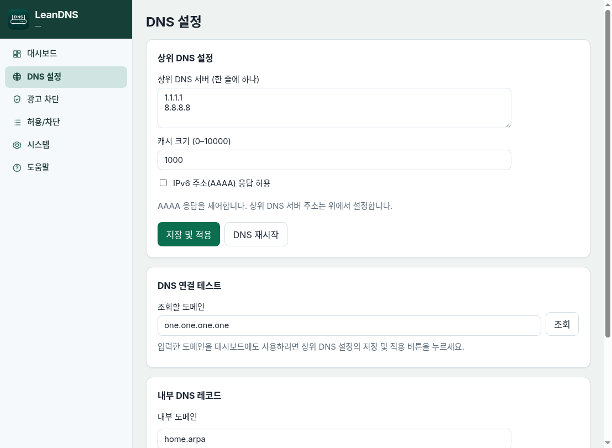
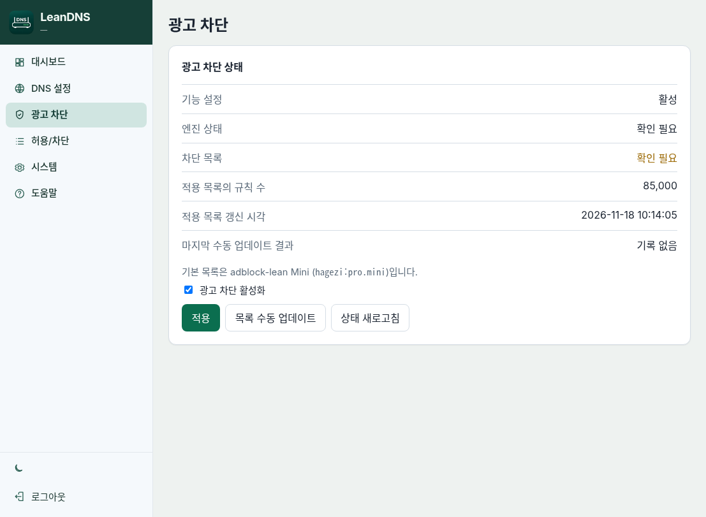
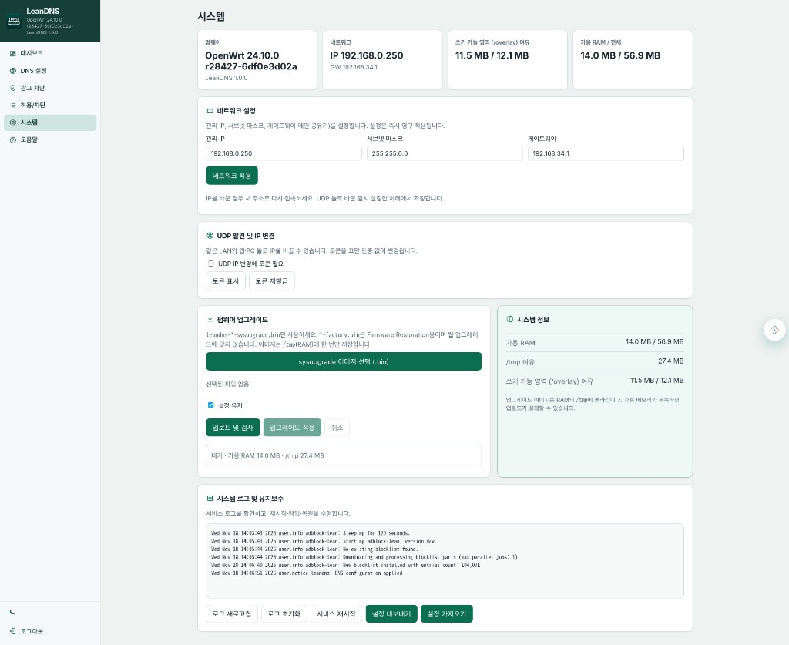

English | [한국어](README.ko.md)

# LeanDNS

An OpenWrt-based **ultra-lightweight smart DNS** management system.

Leave your main router untouched — LeanDNS handles DNS and ad-blocking only.  
The management UI runs on top of dnsmasq + adblock-lean with a **bilingual web interface (English/Korean, auto-detected from browser language)**, without reimplementing a DNS engine.

## Who Is This For

- Anyone who wants to reduce ads and manage DNS centrally on a home/small LAN
- Those who want an AdGuard Home-class management experience but need it to fit on a low-spec router (64 MB RAM / 16 MB Flash)
- Anyone who has lost web access after a subnet change and wants to rediscover and re-IP the device from a phone or PC

## Supported Scope

| Category | Detail |
|----------|--------|
| Theoretically compatible | Any device running **OpenWrt 24.10.x** with dnsmasq, adblock-lean, uhttpd/rpcd, and sufficient Flash/RAM for the above configuration |
| Tested | **ASUS RT-AC750L** (= OpenWrt `asus_rt-ac1200-v2`, 64 MB RAM / 16 MB Flash) |

Other models may differ in board, image, and recovery paths — check the device's OpenWrt documentation alongside [docs/hardware.md](docs/hardware.md).

## Configuration Summary

| Item | Detail |
|------|--------|
| OS | OpenWrt 24.10.x |
| DNS / Ad blocking | dnsmasq + adblock-lean Mini |
| Web UI | `http://<device-IP>/leandns/` (same at root `/`) |
| Auth | OpenWrt **root** + rpcd ubus session (no LuCI UI / luci-base) |
| Default LAN | `192.168.0.250/24`, GW `192.168.0.1`, DHCP server off |
| Image type | DNS-only: Wi-Fi, PPP, firewall4/nft stack excluded (assumed behind main router on LAN) |
| Firmware outputs | `leandns-*-sysupgrade.bin` (web/sysupgrade), `leandns-*-factory.bin` (ASUS Restoration) |
| Device discovery | `leandns-discoverd` (C, UDP **37421**, protocol LEANDNS1) |

For installation, recovery, security, and other details, see the [Documentation](#documentation) section.

## Management UI

Access from a browser at `http://<device-IP>/` or `/leandns/`.  
Manage DNS status, ad blocking, allow/block lists, LAN/UDP settings, and firmware — all from a bilingual web interface.

### Dashboard

Displays DNS and ad-blocking status, RAM/Flash usage, top DNS summary,  
**recent and today's block statistics**, a 10-minute trend chart, and the **20 most recently blocked domains** at a glance.  
Block counts are stored in `/tmp` (RAM only) and reset on reboot.


### DNS Settings

Configure upstream DNS, cache, AAAA responses, connection tests, and internal DNS records.



### Ad Blocking

Toggle adblock-lean Mini lists on/off, trigger manual updates, and check rule counts.

| Item | Detail |
|------|--------|
| Engine | adblock-lean Mini |
| Default list | `hagezi:pro.mini` (Hagezi DNS blocklists) |
| Download (GitHub mirror) | `https://raw.githubusercontent.com/hagezi/dns-blocklists/main/wildcard/pro.mini-onlydomains.txt` |
| Device config | `/etc/adblock-lean/config` (repo: [`configs/adblock-lean.mini.conf`](configs/adblock-lean.mini.conf)) |
| Local allow/block | `/etc/leandns/allow.list`, `/etc/leandns/block.list` (web UI "Allow/Block") |
| Update | Manual update from web UI + daily cron at 05:00 |

The default Mini list is recommended given the 64 MB RAM constraint.  
Installation/deployment: [docs/installation.md](docs/installation.md) · Paths/structure: [docs/architecture.md](docs/architecture.md)



### System

View firmware, network, storage, and RAM status.  
Apply LAN IP/gateway **immediately and permanently**, manage UDP token/SET permission,  
restart services, export/import configuration, and perform **web firmware upgrades**.

- Only `leandns-*-sysupgrade.bin` uploads are accepted (`*-factory.bin` is for Firmware Restoration only).
- The image is stored in `/tmp` (RAM) exactly once; it is applied only after validation and explicit confirmation.
- No automatic download or auto-flash.



## Android App — Device Discovery & LAN IP Change

Even across subnets, the app can discover the device and change its IP as long as both are on the **same router's Wi-Fi**.  
Uses the same protocol as the PC `leandns-tool` (**LEANDNS1 · UDP 37421**).

Source: [`android/leandns-tool/`](android/leandns-tool/)

### Device Discovery

Connect your phone to the home Wi-Fi, then tap **Discover** — LeanDNS devices appear.  
View IP, mask, gateway, MAC, version, and token/SET permission, then tap **Open Web UI** to go directly to the management screen.


### LAN Settings (UDP SET)

Change the discovered device's IP, subnet mask, and gateway, then tap **Apply**.  
"UDP IP Change" must be enabled in the System screen; enter a token if required (leave blank if disabled).  
UDP SET is **temporary** — confirm LAN settings in the web UI **within 120 seconds** after applying. (Settings revert to previous values after the timeout.)  
"Apply Network" in the web UI is immediate and permanent.


### Usage Flow

1. Connect phone to main Wi-Fi
2. In the app, tap **Discover** → select device
3. Enter token if required, then tap **Apply**
4. Confirm LAN settings in the web UI within 120 seconds

Build APK (Windows 11): Open `android\leandns-tool` in Android Studio → **Build → Build APK(s)**  
or `gradlew.bat assembleDebug` → `app\build\outputs\apk\debug\app-debug.apk`

## Same Operations from PC

```bat
leandns-tool-windows-amd64.exe discover

leandns-tool-windows-amd64.exe set ^
  --token "token-shown-in-web-ui" ^
  --ip 192.168.34.250 ^
  --netmask 255.255.255.0 ^
  --gateway 192.168.34.1
```

Build: `./scripts/build-udp-tool.sh` → `dist/leandns-tool/`  
Device daemon: `./scripts/build-discoverd.sh` (C mipsel softfloat)  
Details: [docs/udp-tool.md](docs/udp-tool.md)

## Local UI Preview (host only)

```bash
./host/run.sh
# Browser: http://127.0.0.1:8765/
# Login: any username / any password (except "wrongpassword")
```

Windows 11: Run the same script inside WSL2 or a Python 3 environment.

## Documentation

| Document | Content |
|----------|---------|
| [docs/installation.md](docs/installation.md) | Installation · factory/sysupgrade images |
| [docs/udp-tool.md](docs/udp-tool.md) | UDP discovery / IP configuration (PC & Android) |
| [docs/architecture.md](docs/architecture.md) | Architecture · block statistics policy |
| [docs/hardware.md](docs/hardware.md) | Hardware & compatibility |
| [docs/recovery.md](docs/recovery.md) | Recovery |
| [docs/security.md](docs/security.md) | Security · firmware upload policy |
| [docs/metrics.md](docs/metrics.md) | Size & resource measurements |

> Real-device flashing and destructive network changes must only be performed **after explicit user approval.**  
> Devices not on the tested list must be self-verified before use.
